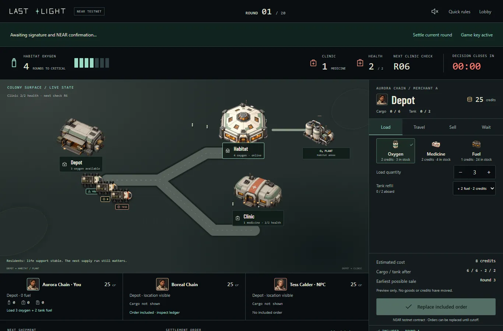

# Last Light

A twenty-round trading strategy game: finish richest while keeping a space colony alive. Two human merchants and one rule-based NPC compete for finite oxygen, medicine and fuel. If the colony collapses, everyone loses.

**[Play the game](https://last-light-colony.faleyeoluwapelumi.chatgpt.site/)** · **[NEAR testnet contract](https://testnet.nearblocks.io/address/last-light-market-a2500d58.testnet)** · **[Judge walkthrough](docs/judge-demo.md)**



## Try it

**Without a wallet:** choose **Play now** for guided practice. Load oxygen and tank fuel, travel to the habitat, then sell in a separate round. Watch cargo, credits and colony oxygen change. Choose **Play both sides** to control both human merchants yourself.

**With two wallets:** choose **Play online**, connect a NEAR testnet wallet, and enable fast actions to avoid signing each move. Create a match, share the code with a second wallet, and ready both merchants. Each decision window lasts fifteen seconds; orders can be replaced before cutoff. Loading, offering, buying, travelling, selling and waiting are separate actions.

Creating a match attaches **0.5 test NEAR** for non-refundable storage, plus gas. Joining uses gas only. Fast actions authorize a restricted key with a **0.25 test NEAR gas allowance** for four game methods; it cannot transfer funds. Use the [NEAR faucet](https://docs.near.org/getting-started/faucet) for testnet funding. Practice needs no wallet. Credits and cargo are match-scoped game units with no cash value.

## What works

- Finite treasury, scheduled shipments and prices responding to delivered stock.
- Rover travel, cargo/tank limits, district storage caps and rotating priority.
- Partial oxygen/medicine fills, minimum payouts and atomic plant conversion.
- Shared survival: oxygen demand each round, medicine deadlines at 6/12/18, and final reserves of at least two oxygen and one medicine.
- Wallet-owned human seats, inventory and credits under one authoritative contract. Inclusion is distinct from an accepted trade.
- Player-set cargo offers, versioned whole-lot purchases, cancellation and atomic player-to-player credit transfers.
- Tess’s [own NEAR wallet](https://testnet.nearblocks.io/address/tess.last-light-market-a2500d58.testnet) with a hosted policy runner and a key restricted to submitting orders.
- Transaction links, match history and recovery with the same wallet after reload.

Tess evaluates district demand, available stock and resale margin. She can buy player offers, post her own asks and deliver unsold cargo herself. Her [policy](game/market.js) is deterministic; the hosted runner signs her decisions independently. A missing signed NPC order becomes wait. NEP-245 items and social login are not implemented. Human enjoyment and strategic balance remain unproven.

## Run locally

Requires **Node.js 24 LTS** (minimum 22.22.2) and npm:

```sh
git clone https://github.com/Pelz01/lastlightgame.git
cd lastlightgame
npm ci
npm start
```

Open **http://127.0.0.1:4173/**. The start script builds the lazy wallet bundle. Practice, pass-and-play, NEAR play and same-network rooms are available. `HOST=127.0.0.1` restricts access to loopback; `PORT` changes the port. Local rooms persist to `data/rooms.json`; set `ROOM_STORE` to a persistent-volume path for a hosted Node service.

The public Worker serves the lightweight client and Tess’s signing service. Practice runs in-browser; online ownership and settlement live on NEAR. D1 stores NPC job leases and public transaction hashes. Human wallet keys never enter the server. Local WebSocket room controls are omitted from the public build. For a local NPC runner, set `NEAR_NPC_KEY_FILE` to the external restricted-key file created by `node scripts/setup-npc-wallet.mjs`.

## Build and test

```sh
npm test                         # JS rules, rooms, identities and durability
npm run build                    # enforces a 1.2 MB client budget
```

Optional Python checks require Python 3.12 or later (`python3` on Linux):

```sh
python3 scripts/verify_release.py # independent model, edge cases, witness and generated data
```

Browser checks require Microsoft Edge and a running local server:

```sh
npm run verify:self-play          # 20 rounds, reload, export and two-tab settlement
npm run verify:interaction        # input and ledger stability during live updates
```

For the contract install Rust 1.86.0 and its `wasm32-unknown-unknown` target. Linux builds natively; the Windows helper uses Ubuntu WSL:

```sh
npm run build:contract
cd contracts/last-light
cargo build --locked --features model-testing --bin trace
cd ../..
npm run verify:near               # preserved v0.2 baseline parity
node scripts/verify-market.mjs     # v0.3 market match + 120 adversarial cases
node tests/market-browser.mjs      # player-to-player market UI
```

The [NEAR integration guide](docs/near-integration.md) covers the Linux WASM sandbox, deployment, restricted keys and recovery. Live testnet browser checks create funded QA accounts and send transactions; they are separate from `npm test`.

## Evidence

The current [merchant-economy evidence](docs/evidence/merchant-economy/README.md) covers a complete **20-round, two-browser testnet match** (`000005`), all twenty NPC signatures, full state parity, actual player-to-player transfer, and receipt recovery. The [evidence index](docs/evidence/README.md) also preserves v0.2 reports. QA wallet setup used a Playwright-injected signer; gameplay used real browser-held restricted keys and real testnet RPC. This is integration evidence, not a human playtest or balance study.

## Source map

| Location | Responsibility |
| --- | --- |
| `client/` | Interface, map, rover motion, wallets and transaction states |
| `game/` | JS rules, NPC policy, local rooms and durable storage |
| `contracts/last-light/` | Rust contract: chain cutoffs, authorization and settlement |
| `scripts/` | Python comparison model, builds, deployment and verification |
| `tests/` | JS and browser checks |
| `design/` | Original masters, optimized artwork, SVGs and prompts |
| `docs/economy-v0.3.md` | Current merchant market and NPC wallet rules |
| `hosting/` | Existing public Site identity and Worker preparation |

## Development history and boundaries

Planning documents and Python economy experiments predate November 1, 2026. The browser game, game assets, multiplayer client and NEAR integration were implemented during the November hackathon development period. Historical planning records are labelled. `site/` contains the earlier concept/replay site, not the playable client.

This is a **testnet release**. The deployment account retains upgrade authority; retained matches are capped at 100. Both players must consent before archiving a finished match. If everyone disconnects, the onchain round waits for settlement; rejoining can resume it. Local persistence supports one Node process, not a multi-instance room cluster. This release is not a mainnet security audit.

## License

Original code and artwork use the [MIT License](LICENSE). The font retains its [SIL Open Font License](design/runtime/FONT-LICENSE.txt). Dependencies retain their licenses; see [third-party notices](THIRD_PARTY_NOTICES.md).
